# MindEase Chatbot Conversation Flow

## Overview

The MindEase chatbot guides users through **26 validated screening questions** across three instruments: **PHQ-9** (9 questions), **GAD-7** (7 questions), and **PSS-10** (10 questions). The conversation is managed by a finite state machine (FSM) on the backend.

---

## Complete State Machine Diagram

```mermaid
stateDiagram-v2
    [*] --> WELCOME

    WELCOME --> CONSENT: User accepts terms
    WELCOME --> [*]: User declines

    CONSENT --> DEMOGRAPHICS: Consent given
    CONSENT --> WELCOME: User goes back

    DEMOGRAPHICS --> PHQ9_START: Demographics submitted

    PHQ9_START --> PHQ9_Q1: Intro message shown

    state "PHQ-9 Block (Depression)" as PHQ9 {
        PHQ9_Q1 --> PHQ9_Q2: Answer recorded
        PHQ9_Q2 --> PHQ9_Q3: Answer recorded
        PHQ9_Q3 --> PHQ9_Q4: Answer recorded
        PHQ9_Q4 --> PHQ9_Q5: Answer recorded
        PHQ9_Q5 --> PHQ9_Q6: Answer recorded
        PHQ9_Q6 --> PHQ9_Q7: Answer recorded
        PHQ9_Q7 --> PHQ9_Q8: Answer recorded
        PHQ9_Q8 --> PHQ9_Q9: Answer recorded
        PHQ9_Q9 --> PHQ9_CRISIS_CHECK: Answer recorded
    }

    PHQ9_CRISIS_CHECK --> CRISIS_PROTOCOL: Q9 answer >= 1
    PHQ9_CRISIS_CHECK --> GAD7_START: Q9 answer == 0

    CRISIS_PROTOCOL --> GAD7_START: User safe / resources provided
    CRISIS_PROTOCOL --> EMERGENCY: Immediate risk detected

    EMERGENCY --> [*]: Crisis resources shown

    GAD7_START --> GAD7_Q1: Transition message shown

    state "GAD-7 Block (Anxiety)" as GAD7 {
        GAD7_Q1 --> GAD7_Q2: Answer recorded
        GAD7_Q2 --> GAD7_Q3: Answer recorded
        GAD7_Q3 --> GAD7_Q4: Answer recorded
        GAD7_Q4 --> GAD7_Q5: Answer recorded
        GAD7_Q5 --> GAD7_Q6: Answer recorded
        GAD7_Q6 --> GAD7_Q7: Answer recorded
        GAD7_Q7 --> GAD7_COMPLETE: Answer recorded
    }

    GAD7_COMPLETE --> PSS10_START: GAD-7 done

    PSS10_START --> PSS10_Q1: Transition message shown

    state "PSS-10 Block (Stress)" as PSS10 {
        PSS10_Q1 --> PSS10_Q2: Answer recorded
        PSS10_Q2 --> PSS10_Q3: Answer recorded
        PSS10_Q3 --> PSS10_Q4: Answer recorded
        PSS10_Q4 --> PSS10_Q5: Answer recorded
        PSS10_Q5 --> PSS10_Q6: Answer recorded
        PSS10_Q6 --> PSS10_Q7: Answer recorded
        PSS10_Q7 --> PSS10_Q8: Answer recorded
        PSS10_Q8 --> PSS10_Q9: Answer recorded
        PSS10_Q9 --> PSS10_Q10: Answer recorded
        PSS10_Q10 --> PSS10_COMPLETE: Answer recorded
    }

    PSS10_COMPLETE --> SCORING: All 26 questions done

    state "Processing" as SCORING {
        SCORING_PHQ9: Compute PHQ-9 Score
        SCORING_GAD7: Compute GAD-7 Score
        SCORING_PSS10: Compute PSS-10 Score (with reversals)
        ML_INFERENCE: Run Random Forest Model
        GENERATE_REPORT: Build Recommendations

        SCORING_PHQ9 --> SCORING_GAD7
        SCORING_GAD7 --> SCORING_PSS10
        SCORING_PSS10 --> ML_INFERENCE
        ML_INFERENCE --> GENERATE_REPORT
    }

    SCORING --> RESULTS
    RESULTS --> DASHBOARD: User views report
    DASHBOARD --> [*]
```



---

## All 26 Questions — Full Reference

### Instrument 1: PHQ-9 (Patient Health Questionnaire-9)
**Timeframe**: *Over the last 2 weeks, how often have you been bothered by any of the following problems?*
**Scale**: 0 = Not at all | 1 = Several days | 2 = More than half the days | 3 = Nearly every day

| # | State ID | Question Text | Crisis Flag |
|---|----------|--------------|-------------|
| 1 | `PHQ9_Q1` | Little interest or pleasure in doing things | ❌ |
| 2 | `PHQ9_Q2` | Feeling down, depressed, or hopeless | ❌ |
| 3 | `PHQ9_Q3` | Trouble falling or staying asleep, or sleeping too much | ❌ |
| 4 | `PHQ9_Q4` | Feeling tired or having little energy | ❌ |
| 5 | `PHQ9_Q5` | Poor appetite or overeating | ❌ |
| 6 | `PHQ9_Q6` | Feeling bad about yourself — or that you are a failure or have let yourself or your family down | ❌ |
| 7 | `PHQ9_Q7` | Trouble concentrating on things, such as reading the newspaper or watching television | ❌ |
| 8 | `PHQ9_Q8` | Moving or speaking so slowly that other people could have noticed? Or the opposite — being so fidgety or restless that you have been moving around a lot more than usual | ❌ |
| 9 | `PHQ9_Q9` | Thoughts that you would be better off dead, or of hurting yourself in some way | ⚠️ **CRISIS** |

---

### Instrument 2: GAD-7 (Generalized Anxiety Disorder-7)
**Timeframe**: *Over the last 2 weeks, how often have you been bothered by the following problems?*
**Scale**: 0 = Not at all | 1 = Several days | 2 = More than half the days | 3 = Nearly every day

| # | State ID | Question Text |
|---|----------|--------------|
| 10 | `GAD7_Q1` | Feeling nervous, anxious, or on edge |
| 11 | `GAD7_Q2` | Not being able to stop or control worrying |
| 12 | `GAD7_Q3` | Worrying too much about different things |
| 13 | `GAD7_Q4` | Trouble relaxing |
| 14 | `GAD7_Q5` | Being so restless that it's hard to sit still |
| 15 | `GAD7_Q6` | Becoming easily annoyed or irritable |
| 16 | `GAD7_Q7` | Feeling afraid as if something awful might happen |

---

### Instrument 3: PSS-10 (Perceived Stress Scale-10)
**Timeframe**: *In the last month, how often have you...*
**Scale**: 0 = Never | 1 = Almost Never | 2 = Sometimes | 3 = Fairly Often | 4 = Very Often

| # | State ID | Question Text | Scoring |
|---|----------|--------------|---------|
| 17 | `PSS10_Q1` | Been upset because of something that happened unexpectedly? | Normal |
| 18 | `PSS10_Q2` | Felt that you were unable to control the important things in your life? | Normal |
| 19 | `PSS10_Q3` | Felt nervous and stressed? | Normal |
| 20 | `PSS10_Q4` | Felt confident about your ability to handle your personal problems? | **Reversed** |
| 21 | `PSS10_Q5` | Felt that things were going your way? | **Reversed** |
| 22 | `PSS10_Q6` | Found that you could not cope with all the things you had to do? | Normal |
| 23 | `PSS10_Q7` | Been able to control irritations in your life? | **Reversed** |
| 24 | `PSS10_Q8` | Felt that you were on top of things? | **Reversed** |
| 25 | `PSS10_Q9` | Been angered because of things that were outside of your control? | Normal |
| 26 | `PSS10_Q10` | Felt difficulties were piling up so high that you could not overcome them? | Normal |

> **Reverse Scoring**: For items 4, 5, 7, 8 — use `reversed_value = 4 - raw_value`

---

## Conversation Script & LLM Prompts

### Session Opening

```
WELCOME MESSAGE:
"Hi! I'm MindEase 👋 — your private mental wellness companion. 
I'll ask you 26 questions from three validated clinical screening tools 
to help you understand your mental wellbeing. This takes about 5–7 minutes.

Everything you share is confidential and encrypted. Ready to begin?"

[Button: "Yes, let's start" | "Learn more"]
```

### PHQ-9 Introduction (State: PHQ9_START)

```
"Great! Let's start with some questions about how you've been feeling 
over the past two weeks. There are no right or wrong answers — 
just be as honest as you can. 💙"
```

### Between-Instrument Transitions (LLM-Generated)

```
PHQ9 → GAD7 Transition Prompt (sent to Groq):
"The user has just completed the depression screening (PHQ-9). 
Transition empathetically to the anxiety screening (GAD-7). 
Be warm, validating, and brief (2-3 sentences). 
Do not reveal scores or make clinical judgments."

GAD7 → PSS10 Transition Prompt:
"The user has completed anxiety screening questions. 
Transition warmly to the stress perception section (PSS-10). 
Acknowledge their effort and explain this section covers the past month. 
Be encouraging and brief."
```

### Crisis Protocol (State: CRISIS_PROTOCOL)

```
TRIGGER: PHQ-9 Q9 answer >= 1 (any level of suicidal ideation)

IMMEDIATE RESPONSE:
"Thank you for trusting me with something so important. 
Your safety matters most right now. 💙

If you're having thoughts of harming yourself, please reach out:
📞 National Suicide Prevention Lifeline: 988 (US)
📞 Crisis Text Line: Text HOME to 741741
📞 International Association for Suicide Prevention: https://www.iasp.info/resources/Crisis_Centres/

Are you currently safe? I'm here with you."

BACKEND ACTION:
- Set session.crisis_flag = True
- Create CrisisAlert record
- Log alert for clinical review
- Continue screening only if user confirms safety
```

### Answer Scale Labels

```python
PHQ9_GAD7_LABELS = {
    0: "Not at all",
    1: "Several days",
    2: "More than half the days",
    3: "Nearly every day"
}

PSS10_LABELS = {
    0: "Never",
    1: "Almost never",
    2: "Sometimes",
    3: "Fairly often",
    4: "Very often"
}
```

---

## State Machine Implementation (Python Pseudocode)

```python
from enum import Enum
from dataclasses import dataclass
from typing import Optional

class SessionState(str, Enum):
    WELCOME = "WELCOME"
    CONSENT = "CONSENT"
    DEMOGRAPHICS = "DEMOGRAPHICS"
    PHQ9_Q1 = "PHQ9_Q1"
    PHQ9_Q2 = "PHQ9_Q2"
    PHQ9_Q3 = "PHQ9_Q3"
    PHQ9_Q4 = "PHQ9_Q4"
    PHQ9_Q5 = "PHQ9_Q5"
    PHQ9_Q6 = "PHQ9_Q6"
    PHQ9_Q7 = "PHQ9_Q7"
    PHQ9_Q8 = "PHQ9_Q8"
    PHQ9_Q9 = "PHQ9_Q9"
    CRISIS_PROTOCOL = "CRISIS_PROTOCOL"
    GAD7_Q1 = "GAD7_Q1"
    GAD7_Q2 = "GAD7_Q2"
    GAD7_Q3 = "GAD7_Q3"
    GAD7_Q4 = "GAD7_Q4"
    GAD7_Q5 = "GAD7_Q5"
    GAD7_Q6 = "GAD7_Q6"
    GAD7_Q7 = "GAD7_Q7"
    PSS10_Q1 = "PSS10_Q1"
    PSS10_Q2 = "PSS10_Q2"
    PSS10_Q3 = "PSS10_Q3"
    PSS10_Q4 = "PSS10_Q4"
    PSS10_Q5 = "PSS10_Q5"
    PSS10_Q6 = "PSS10_Q6"
    PSS10_Q7 = "PSS10_Q7"
    PSS10_Q8 = "PSS10_Q8"
    PSS10_Q9 = "PSS10_Q9"
    PSS10_Q10 = "PSS10_Q10"
    SCORING = "SCORING"
    RESULTS = "RESULTS"
    COMPLETE = "COMPLETE"

STATE_SEQUENCE = [
    SessionState.PHQ9_Q1, SessionState.PHQ9_Q2, SessionState.PHQ9_Q3,
    SessionState.PHQ9_Q4, SessionState.PHQ9_Q5, SessionState.PHQ9_Q6,
    SessionState.PHQ9_Q7, SessionState.PHQ9_Q8, SessionState.PHQ9_Q9,
    SessionState.GAD7_Q1, SessionState.GAD7_Q2, SessionState.GAD7_Q3,
    SessionState.GAD7_Q4, SessionState.GAD7_Q5, SessionState.GAD7_Q6,
    SessionState.GAD7_Q7,
    SessionState.PSS10_Q1, SessionState.PSS10_Q2, SessionState.PSS10_Q3,
    SessionState.PSS10_Q4, SessionState.PSS10_Q5, SessionState.PSS10_Q6,
    SessionState.PSS10_Q7, SessionState.PSS10_Q8, SessionState.PSS10_Q9,
    SessionState.PSS10_Q10,
]

PSS10_REVERSE_ITEMS = {SessionState.PSS10_Q4, SessionState.PSS10_Q5,
                       SessionState.PSS10_Q7, SessionState.PSS10_Q8}
```

---

## API Endpoints for Conversation Flow

| Method | Endpoint | Description | Auth |
|--------|----------|-------------|------|
| `POST` | `/api/v1/sessions/start` | Initialize new screening session | ✅ JWT |
| `POST` | `/api/v1/sessions/{id}/answer` | Submit answer, get next question | ✅ JWT |
| `GET` | `/api/v1/sessions/{id}/state` | Get current session state | ✅ JWT |
| `GET` | `/api/v1/sessions/{id}/results` | Get completed session results | ✅ JWT |
| `POST` | `/api/v1/sessions/{id}/crisis-safe` | User confirms safety (crisis flow) | ✅ JWT |
| `GET` | `/api/v1/sessions/history` | List all user sessions | ✅ JWT |

---

## Progress Tracking

The frontend displays a progress bar calculated as:

```
progress = (current_question_index / 26) * 100

Instrument indicators:
- Questions 1–9:   PHQ-9  (Depression)
- Questions 10–16: GAD-7  (Anxiety)
- Questions 17–26: PSS-10 (Stress)
```
